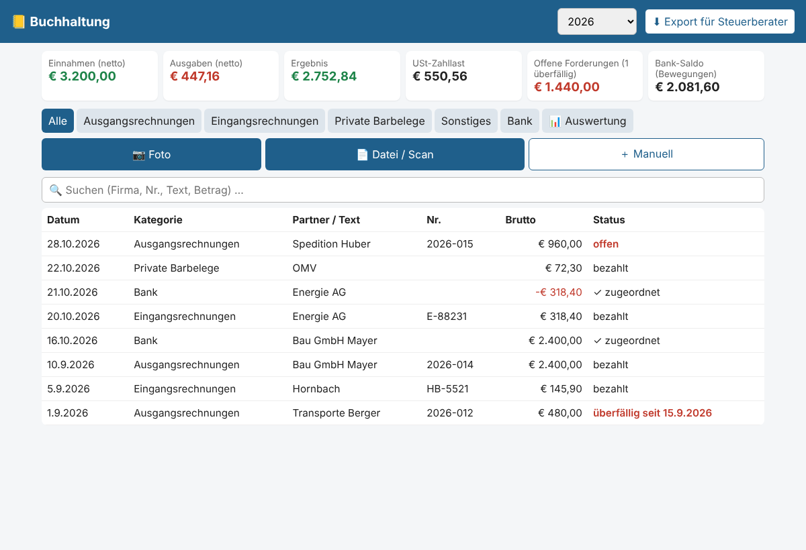

# Buchhaltung – einfach

Belege sammeln in 5 Rubriken: **Ausgangsrechnungen, Eingangsrechnungen, Private Barbelege, Sonstiges, Bank**.

## Start
1. Python 3 installieren (python.org, bei Windows „Add to PATH“ anhaken).
2. Doppelklick auf `start.bat` (oder `python server.py`).
3. PC: http://localhost:8765 · Handy (gleiches WLAN): Adresse wird im Fenster angezeigt, z. B. `http://192.168.0.20:8765` → im Handy-Browser „Zum Startbildschirm hinzufügen“.

## Belege erfassen
- **📷 Foto**: öffnet die Handykamera direkt.
- **📄 Datei / Scan**: Scan-Funktion des Handys (z. B. Google Drive / iPhone Notizen-Scan als PDF) oder vorhandene Datei wählen.
- Danach öffnet sich das Formular → Betrag, USt, Partner eintragen → Speichern. Belege ohne Betrag sind gelb markiert.
- Die Rubrik wird vom aktuell gewählten Tab übernommen.

## Handy: „Teilen → Buchhaltung“
Foto/Scan machen → **Teilen** → **Buchhaltung** → Beleg wird gespeichert, ausgelesen und in die richtige Rubrik einsortiert.
Danach öffnet sich der Beleg kurz zur Kontrolle.

Voraussetzung: Handy im selben WLAN, PC läuft. Tipp: im Router dem PC eine **feste IP** geben, sonst ändert sich die Adresse.

**Android (Chrome)** – einmalig:
1. In Chrome `chrome://flags/#unsafely-treat-insecure-origin-as-secure` öffnen, die Adresse aus dem Startfenster eintragen
   (z. B. `http://192.168.0.20:8765`), auf *Enabled* stellen, *Relaunch*.
   (Nötig, weil Chrome „Teilen an App“ sonst nur über HTTPS erlaubt.)
2. Die Adresse öffnen → Menü ⋮ → **App installieren**.
3. Ab jetzt erscheint „Buchhaltung“ im Teilen-Menü (Kamera, Galerie, Google-Drive-Scan, Dateien).

**iPhone** – einmalig Kurzbefehl anlegen (Kurzbefehle-App → ＋):
1. Details → *Im Share-Sheet anzeigen* einschalten, Typen: Bilder, PDFs.
2. Aktion **Bild konvertieren** → JPEG (nur für Fotos; für PDFs weglassen bzw. zweiten Kurzbefehl).
3. Aktion **Inhalte von URL abrufen**: URL `http://192.168.0.20:8765/api/upload?kategorie=auto&name=beleg.jpg`,
   Methode *POST*, Anfragetext *Datei* → Kurzbefehl-Eingabe.
4. Name: „An Buchhaltung“. Danach: Teilen → *An Buchhaltung*.

**Unterwegs (ohne WLAN):** Beleg per Teilen in einen Google-Drive-/OneDrive-Ordner speichern, der am PC synchronisiert
wird, und diesen Ordner in `config.json` bei `"auto"` eintragen. Er wird beim nächsten PC-Start automatisch übernommen.

## Automatische Belegerkennung (optional, empfohlen)
Ohne Erkennung musst du Betrag & Co. selbst eintippen. Mit Erkennung liest Claude (KI von Anthropic) aus Foto/PDF:
Rubrik, Datum, Firma, Rechnungsnummer, Bruttobetrag, USt-Satz.
1. `pip install anthropic`
2. API-Key auf https://console.anthropic.com erstellen und in `config.json` bei `"anthropic_api_key"` eintragen.
3. Bei `"eigene_firma"` deinen Namen/Firmennamen eintragen (damit eigene Rechnungen als *Ausgangsrechnung* erkannt werden).

Kosten: ca. 1–2 Cent pro Beleg (Modell in `"ki_modell"`; `claude-haiku-5-5` ist deutlich billiger, aber ungenauer).
Datenschutz: Die Belegbilder werden dafür an Anthropic übertragen.
Im Tab **Alle** wird die Rubrik automatisch erkannt; in einem bestimmten Tab gilt immer dieser Tab.

## Ausgangsrechnungen automatisch übernehmen
Speichere deine am PC erstellte Rechnung (PDF) in den Ordner
`eingang_ordner/ausgangsrechnungen` – sie wird innerhalb von ~10 s automatisch gebucht und die Datei in `daten/belege/` abgelegt.
Den Ordner kannst du in `config.json` ändern (z. B. auf deinen bestehenden Rechnungsordner).
Gleiches gibt es für `eingangsrechnungen`, `barbelege`, `sonstiges` – praktisch, wenn die Handy-Scan-App in einen
OneDrive-/Google-Drive-Ordner speichert, der am PC synchronisiert wird.

Optional: `pip install pypdf` → Rechnungsnummer, Datum und Gesamtbetrag werden aus PDF-Rechnungen automatisch ausgelesen.

## Bank
Tab **Bank** → „Bank-CSV importieren“ (z. B. George-Export). Spalten Datum/Betrag/Text werden automatisch erkannt.

## Daten & Sicherung
- Alles liegt in `daten/` (Datenbank + Belegdateien nach Rubrik/Jahr). **Diesen Ordner regelmäßig sichern** (7 Jahre Aufbewahrungspflicht).
- Gelöschte Belege landen in `daten/papierkorb/`.
- **CSV-Export** pro Jahr für Steuerberater/Excel.

Hinweis: kein Passwortschutz – nur im eigenen Heim-WLAN betreiben, nicht ins Internet freigeben.
